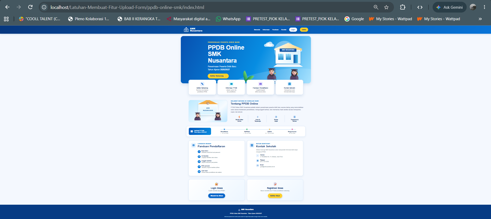
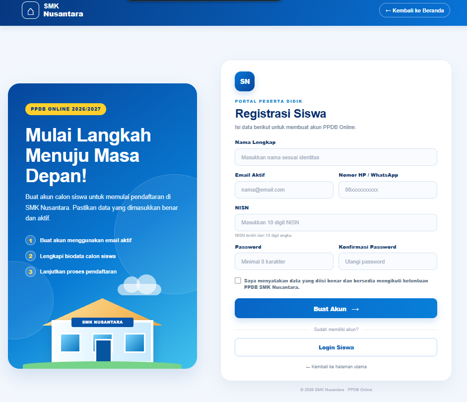
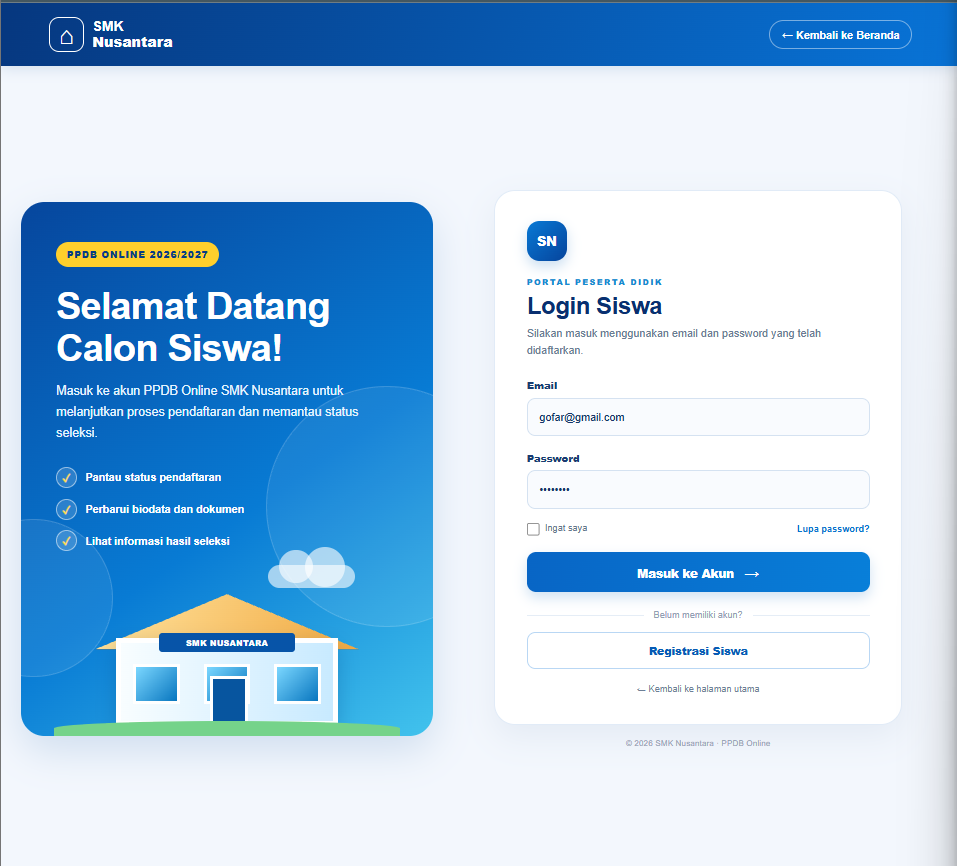
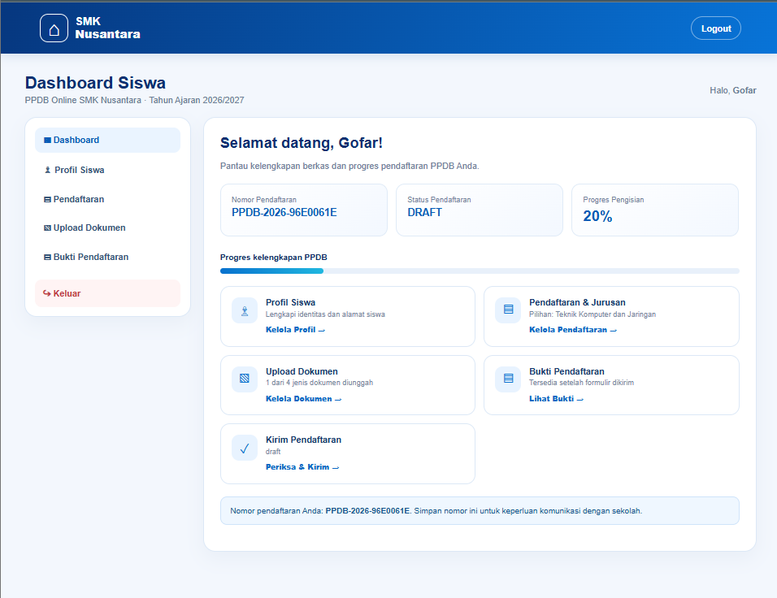
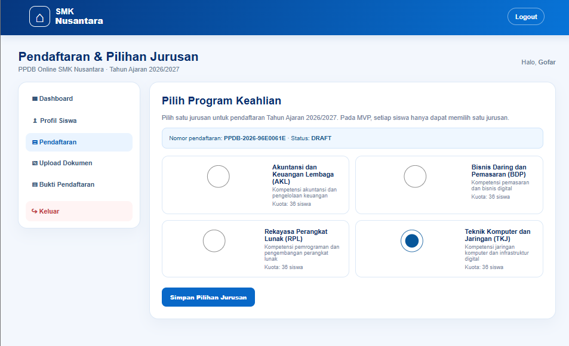
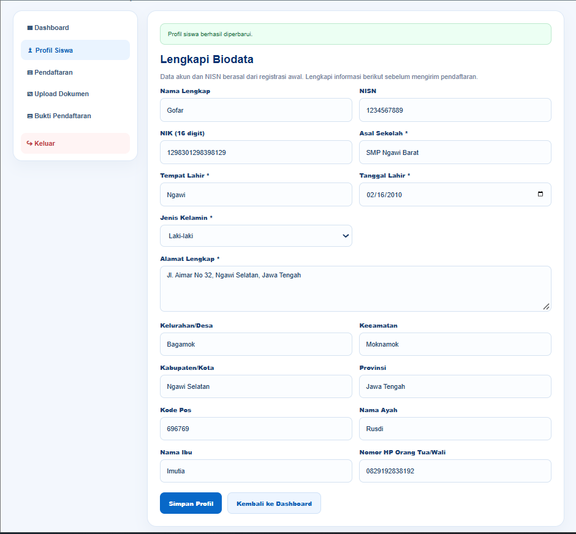
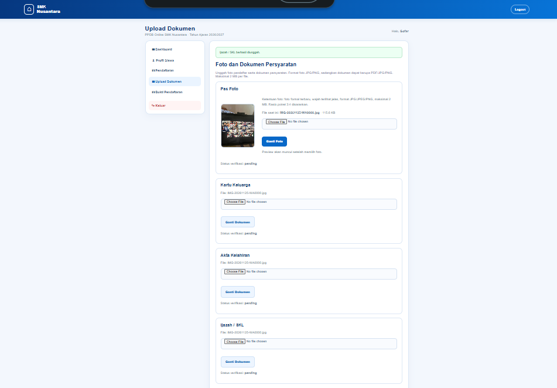
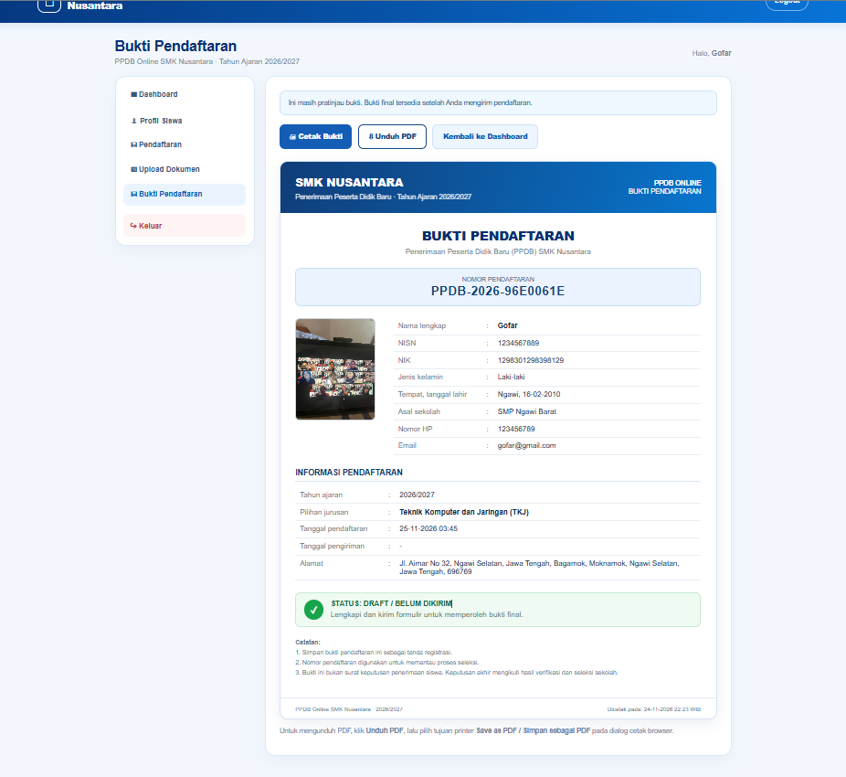

# Dokumentasi Website PPDB Online SMK Nusantara

Website ini dibuat sebagai portal pendaftaran siswa baru (PPDB) untuk SMK Nusantara. Berawal dari tugas sebelumnya yang hanya berupa sistem *Register* dan *Login* dasar, proyek ini telah dikembangkan menjadi sistem informasi pendaftaran yang utuh dengan integrasi *backend* PHP (PDO) dan *database* MySQL yang saling berelasi.

Link website: jalan di localhost

---

### Identitas
Nama: Benedictus Imanuel Wicaksono  
NRP: 5025251039

---

## 1. Wireframe & Antarmuka Website

> Bagian Halaman Utama (Landing Page):

> Bagian Form Registrasi & Login:
 

> Bagian Dashboard & Pendaftaran:
 

> Profil Siswa:
 

> Bagian Upload Dokumen:

> Bagian Bukti Pendaftaran

---

## 2. Pembagian Halaman & File

Di dalam proyek ini terdapat beberapa file yang terbagi berdasarkan fungsinya:

> Halaman Registrasi
[Registrasi](ppdb-online-smk/register.php)

> Halaman Dashboard Siswa
[Dashboard](ppdb-online-smk/dashboard.php)

> Halaman Upload Dokumen & Preview
[Upload](ppdb-online-smk/dokumen.php)

*   `index.html`  
    Halaman beranda utama (landing page) yang menampilkan informasi umum PPDB.
*   `register.php` & `login.php`  
    Halaman autentikasi siswa. Memproses pembuatan akun baru dan sesi masuk.
*   `dashboard.php` & `profil.php`  
    Halaman utama siswa setelah login dan halaman untuk melengkapi biodata diri.
*   `pendaftaran.php`  
    Halaman untuk memilih jurusan (TKJ, RPL, AKL, BDP) dan membuat draf pendaftaran.
*   `dokumen.php`  
    Halaman untuk mengunggah berkas persyaratan (Pas Foto, KK, Akta, Ijazah).
*   `config/database.php` & `includes/bootstrap.php`  
    File konfigurasi koneksi PDO ke MySQL dan inisialisasi *session*, keamanan, serta fungsi bantuan (*helpers*).
*   `storage/dokumen/`  
    Folder lokal (di luar akses langsung web) untuk menyimpan file gambar/PDF yang diunggah siswa secara aman.

---

## 3. Fitur Tambahan (Dari Tugas Sebelumnya)

Sebelumnya, proyek ini hanya memiliki fitur dasar `register.php` dan `login.php` yang terhubung ke satu tabel sederhana. Berikut adalah **penjelasan apa saja yang ditambahkan** pada versi PPDB Online ini:

1.  **Ekspansi Struktur Database & Relasi (Foreign Key)**: 
    Menambahkan tabel `siswa`, `jurusan`, `pendaftaran`, `dokumen_pendaftaran`, dan `riwayat_status`. Relasi antar tabel menggunakan *Foreign Key* (contoh: `user_id` di tabel `siswa` terhubung ke tabel `users`).
2.  **Sistem Autentikasi Lanjutan (PDO & Transaction)**:
    Proses registrasi tidak lagi sekadar *INSERT* biasa, melainkan menggunakan *Database Transaction* (Commit/Rollback) agar jika proses insert ke tabel `users` berhasil namun gagal di tabel `siswa`, data akan dibatalkan seluruhnya (mencegah *orphan data*).
3.  **Fitur Unggah Dokumen (Secure File Upload)**:
    Sistem memvalidasi *MIME type* file menggunakan `finfo` (hanya memperbolehkan JPG/PNG/PDF), membatasi ukuran maksimal 2 MB, dan menyimpan file dengan nama acak (enkripsi `bin2hex(random_bytes())`) agar aman dari eksekusi *script* berbahaya.
4.  **Live Image Preview (JavaScript)**:
    Menambahkan *event listener* pada form upload agar saat siswa memilih file foto, gambar langsung muncul di dalam kotak preview sebelum benar-benar diunggah ke server.
5.  **Session Management & CSRF Token**:
    Menambahkan token keamanan (CSRF) pada setiap form untuk mencegah serangan *Cross-Site Request Forgery*.

---

## 4. Source Code Fitur Tambahan

Berikut adalah kode sumber utama yang ditambahkan untuk mendukung fitur-fitur baru di atas:

### A. Struktur Database Baru (Tabel Relasi)
[Database](ppdb-online-smk/upgrade-existing.sql)